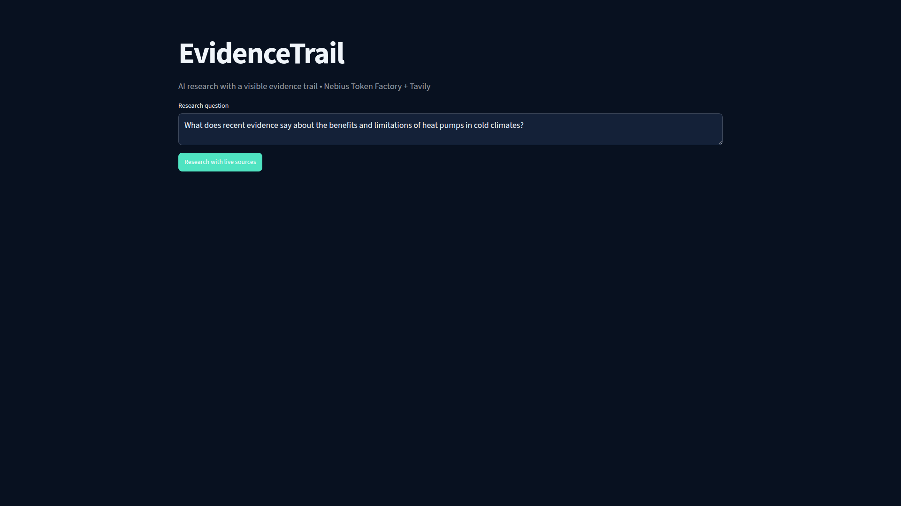
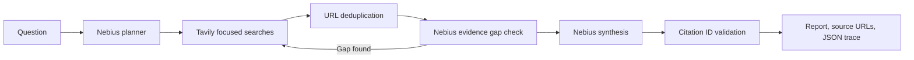

# EvidenceTrail

Built for the ODSC × Nebius Hackathon from the [official project template](https://github.com/odsc2015/nebius-research-agent-hackaton-template).

**Live verification status:** Tavily search and Nebius model listing work. Nebius chat completion currently returns HTTP 402 `credit_balance_exhausted`; the full agent flow is awaiting free credits. See [EVIDENCE.md](EVIDENCE.md).

EvidenceTrail is a research agent that turns a question into a traceable report. It uses [Nebius Token Factory](https://tokenfactory.nebius.com/) for planning, evidence evaluation, and synthesis, and [Tavily](https://tavily.com/) for live search. Every citation ID is checked against the retrieved source list before the report is shown.

It is intended for students, analysts, and researchers who need a fast first pass on a question while keeping the source trail available for their own review.



## Architecture



## Setup

1. Use Python 3.12 or newer and install `requirements.txt` into a virtual environment.
2. Copy `.env.example` to `.env` and enter `NEBIUS_API_KEY`, `TAVILY_API_KEY`, and a model ID available in your Nebius account as `NEBIUS_MODEL`. `.env` is ignored by Git.
3. Run `streamlit run app.py` from this directory.
4. Ask a question of at least 12 characters and click **Research with live sources**.

On this Ubuntu machine, `python3-venv` is unavailable. The verified local setup is:

```bash
python3 -m pip install --target .deps -r requirements.txt
PYTHONPATH=.deps python3 -m streamlit run app.py --global.developmentMode false --server.address 127.0.0.1
```

For a CLI live run that saves the JSON trace under the ignored `artifacts/` directory, use `PYTHONPATH=.deps python3 scripts/live_run.py`.

## Research flow

The planner makes two focused queries. Tavily returns source URLs and extracted snippets. EvidenceTrail merges duplicate URLs while preserving the first original URL. Nebius checks for a material gap and can request one extra search. It then writes a report using source IDs such as `[S1]`. Unknown citation IDs, reports without citations, and unverified URLs are rejected. Valid IDs become links to the exact retrieved URLs in the app. The app also exports a JSON trace containing all search and inference steps.

## Test

```bash
PYTHONPATH=.deps python3 -m pytest -q
```

The unit tests cover URL deduplication and fabricated citation rejection. A live integration run requires valid API keys and account credits; results must be recorded separately, never inferred from unit tests.

## Example question

> What does recent evidence say about the benefits and limitations of heat pumps in cold climates?

Live results vary with the search index and model. Each run records its exact sources, queries, model, and event timestamps.

## Limitations

- Search snippets can omit context. Open the original sources before relying on important claims.
- Citation validation verifies that an ID maps to a retrieved URL, not that the page supports every word of the claim.
- EvidenceTrail does not independently establish source credibility or access paywalled content.
- Availability, costs, and model IDs depend on the user's Nebius and Tavily accounts.

## Integration evidence

See `EVIDENCE.md` for the latest verified run. Do not treat an empty evidence record as a successful integration.
